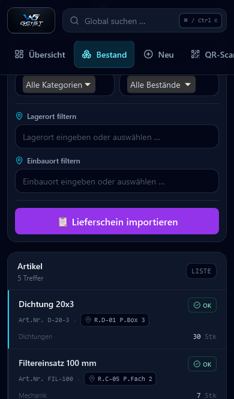
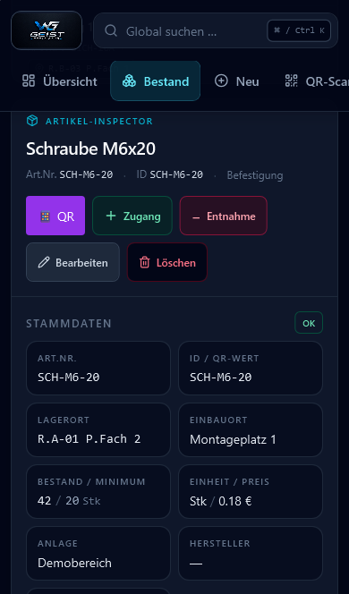
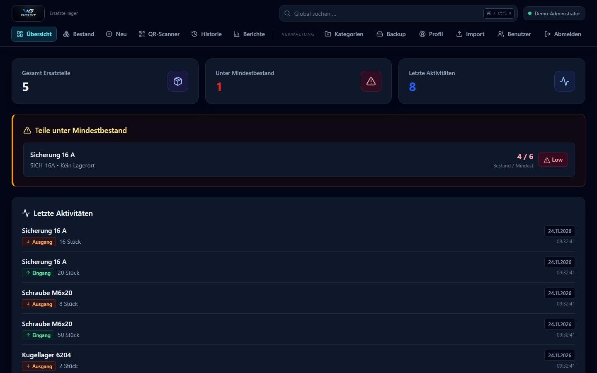
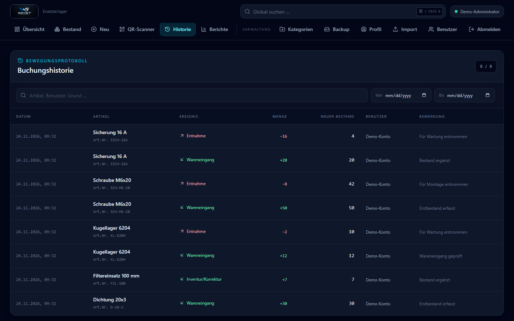

# Ersatzteil- und Lagerverwaltung

Leere, selbst einrichtende React/Vite-Anwendung mit PocketBase. Das Repository enthält weder Datenbank, Benutzer, Zugangsdaten noch Demo- oder Firmendaten. Schema, API-Regeln und der erste App-Administrator werden bei der jeweiligen Ersteinrichtung erzeugt.

Herausgeber: **Geist Techworks** · Kontakt: [geisttechworks@proton.me](mailto:geisttechworks@proton.me)

## Lizenz

Der eigene Programmcode steht unter der [PolyForm Noncommercial License 1.0.0](LICENSE.md): Die private und sonstige nicht-kommerzielle Nutzung ist kostenlos. Kommerzielle Nutzung ist nur nach vorheriger schriftlicher Absprache mit [geisttechworks@proton.me](mailto:geisttechworks@proton.me) zulässig. PolyForm Noncommercial 1.0.0 ist keine Open-Source-Lizenz im Sinne der Open Source Initiative (OSI). Drittanbieterkomponenten bleiben unter ihren jeweiligen Lizenzen; Inventar und unveränderte Lizenztexte stehen in [THIRD-PARTY-LICENSES.md](THIRD-PARTY-LICENSES.md).

## Download und Installation für Anwender

Die aktuelle Installationsdatei steht unter [GitHub Releases – neueste Version](https://github.com/geisttechworks/ersatzteillager/releases/latest) bereit. Laden Sie für Windows 10 oder Windows 11 (64 Bit) `Ersatzteillager-Setup-<Version>.exe` und die gleichnamige Datei mit der Endung `.sha256` herunter. Prüfen Sie anschließend die Installationsdatei in PowerShell:

```powershell
Get-FileHash .\Ersatzteillager-Setup-<Version>.exe -Algorithm SHA256
```

Vergleichen Sie den angezeigten Hash vollständig mit dem ersten Wert aus `Ersatzteillager-Setup-<Version>.exe.sha256` und starten Sie die EXE nur bei Übereinstimmung. Beim ersten Start kann Windows SmartScreen einmalig warnen, weil der Installer nicht digital signiert ist. Die Anwendung ist für den Betrieb im privaten WLAN ausgelegt, nicht für eine direkte Veröffentlichung im Internet.

Die vollständige Anleitung für Installation, Ersteinrichtung, Zertifikat, Handy-Zugang, Backup, Update und Deinstallation steht in [deploy/windows-installer/README-INSTALLATION.md](deploy/windows-installer/README-INSTALLATION.md).

## Screenshots

### Handy

| Bestandsliste | Teilansicht mit Entnahme |
|---|---|
|  |  |

### PC





## Für Entwickler

### Voraussetzungen

- Windows x64 und PowerShell 7
- Node.js 22 LTS mit `npm`
- Git
- ausgehender HTTPS-Zugriff für den einmaligen PocketBase-Download

Geprüfte Backend-Version: PocketBase `0.40.6`. Das Schema verwendet das Migrationsformat `fields` aus PocketBase 0.23+.

### Installation von null

```powershell
git clone https://github.com/geisttechworks/ersatzteillager.git ersatzteillager
Set-Location ersatzteillager
Set-ExecutionPolicy -Scope Process Bypass
./Setup-Factory.ps1 `
  -PocketBaseVersion 0.40.6 `
  -PocketBaseDownloadRoot 'https://github.com/pocketbase/pocketbase/releases/download/'
```

Das Skript fragt Superuser-E-Mail/-Passwort und den ersten App-Administrator verdeckt ab. Passwörter werden weder gespeichert noch ausgegeben. Es lädt PocketBase nach `tools/`, verifiziert die offizielle SHA-256-Prüfsumme, führt `npm ci`, die Migration und den Build aus und legt nur die lokale, ignorierte `.env.local` an.

Danach startet die Entwicklungsumgebung mit:

```powershell
./Start-App.ps1
```

Die Collections sind zunächst leer. Kategorien und Ersatzteile werden ausschließlich über die App angelegt; Demo-Daten werden nicht automatisch erzeugt.

### Windows-Installer für Selbstbetrieb

Für eine eigenständige Installation ohne Entwicklungswerkzeuge steht ein allgemeines Windows-Paket zur Verfügung. Es enthält den Produktions-Build, PocketBase, Migrationen, Caddy für lokales HTTPS, die Ersteinrichtung, eine mobile QR-Anleitung sowie Backup-, Start- und Stoppskripte. Es enthält keine Konten, Passwörter oder Demodaten.

```powershell
./New-WindowsInstaller.ps1 -Version 1.0.1
```

Das Ergebnis liegt ignoriert unter `output/windows-installer/` als `Ersatzteillager-Setup-<Version>.exe` samt SHA-256-Datei. Betreiber legen beim ersten Start ihren eigenen App-Administrator an. Ein zufälliger Bootstrap-Superuser existiert nur während der lokalen Einrichtung und wird anschließend entfernt.

Der mobile Zugriff ist ausschließlich im gleichen privaten WLAN vorgesehen:

```text
Handy/Browser ── lokales HTTPS :8443 ── Caddy ── Loopback :8090 ── PocketBase
```

Die Einrichtungsseite auf Port 8080 verteilt nur die lokale Anleitung und das öffentliche Stammzertifikat. Es gibt keinen Cloudflare-Tunnel, keine Router-Portfreigabe und keine Veröffentlichung ins Internet. Das lokale Zertifikat muss einmal auf jedem freigegebenen Mobilgerät installiert und als vertrauenswürdig aktiviert werden. Ausführliche Betreiberanleitung: [deploy/windows-installer/README-INSTALLATION.md](deploy/windows-installer/README-INSTALLATION.md).

### Konfiguration

`.env.example` und `.env.gemini.example` enthalten ausschließlich leere Variablen. Lokale Werte gehören in `.env.local` beziehungsweise `.env.gemini.local`; beide Dateien sind ignoriert.

| Variable | Zweck |
|---|---|
| `VITE_POCKETBASE_URL` | API-Origin in der Entwicklung; leer bedeutet aktuelle Browser-Origin |
| `VITE_DELIVERY_NOTE_AI_ENDPOINT` | optionaler, vom Betreiber bereitgestellter Lieferschein-KI-Endpunkt |
| `VITE_LOCAL_AI_ENDPOINT` | optionaler lokaler Adapter-Endpunkt |
| `VITE_GEMINI_KEY_SETUP_URL` | optionaler interner Link zur Schlüsselverwaltung |
| `VITE_PASSWORD_RESET_ENABLED` | nur bei fertig konfiguriertem SMTP auf `true` setzen; aktiviert Reset-E-Mails |
| `ERSATZTEILLAGER_ORIGIN` | freigegebene HTTPS-Origin für den Produktionsstart |

Für Gemini gelten zusätzlich die Variablen aus `.env.gemini.example`; siehe [Gemini-Adapter-Anleitung.md](Gemini-Adapter-Anleitung.md).

### Produktion und HTTPS

```powershell
./Build-Production.ps1
Copy-Item .env.example .env
# .env bearbeiten: APP_ORIGIN, Datenpfad und Reverse-Proxy-Werte
./Start-Production.ps1
```

Der Build landet in `pb_public`; PocketBase liefert App und API aus derselben Origin. PocketBase bleibt standardmäßig an Loopback gebunden. `Caddyfile.example` nutzt nur Umgebungsvariablen (`APP_HOST`, `TLS_CERT_FILE`, `TLS_KEY_FILE`, `POCKETBASE_UPSTREAM`). Zertifikat, DNS, Firewall und Vertrauensstellung richtet der Betreiber ein. Kamera/QR-Scanner funktionieren mobil nur über HTTPS oder localhost.

### Server-Paket für den Betrieb

Das plattformneutrale Release enthält PocketBase für Windows und Linux amd64, den fertigen Build in `pb_public`, Migrationen, Start-/Stoppskripte, Ersteinrichtung, Backup-Spiegel, Caddy-/nginx-Vorlagen, Prüfsummen und Anwenderdokumentation:

```powershell
python -m pip install -r requirements-docs.txt
python scripts/new_user_guide_pdf.py
./New-ReleasePackage.ps1 -ReleaseVersion 1.0.1 -PocketBaseVersion 0.40.6
./Test-ReleasePackage.ps1
```

Das Ergebnis liegt ignoriert unter `output/release/`. Der Paketbau lädt beide offiziellen PocketBase-Archive und akzeptiert sie nur bei passender Hersteller-SHA-256-Prüfsumme. Das Paket enthält ausschließlich `.env.example`; Zugangsdaten werden erst nach dem Entpacken interaktiv eingerichtet. Die spätere Aufnahme in einen Windows-Dienst oder Container erfordert keine Änderung an App, Migrationen oder Datenpfaden.

Paketquellen und ausführliche Betriebsanleitung: [deploy/README.md](deploy/README.md) und [deploy/IT-INSTALLATION.md](deploy/IT-INSTALLATION.md).

## Installation auf iPhone und Android

Die App ist eine Online-PWA; eine Veröffentlichung im App Store ist nicht nötig. Betreiber verteilen `https://lager.firma.example/installieren` als Link oder QR-Code.

- iOS 16+: in Safari **Teilen → Zum Home-Bildschirm → Als Web-App öffnen → Hinzufügen**.
- Android 10+: in Chrome **⋮ → App installieren** beziehungsweise **Zum Startbildschirm hinzufügen**.

Nach dem ersten mobilen Login führt der Assistent durch Installation, Kameraberechtigung und eine echte Testbuchung. Ohne vertrauenswürdiges HTTPS zeigt die App eine verständliche Sperrmeldung für Installation und Kamera. Offline-Buchungen sind absichtlich nicht vorgesehen. Etikettendruck und alle Druckschaltflächen werden unter 768 px sowie auf Touch-Geräten vollständig ausgeblendet; der Desktopdruck bleibt unverändert.

## Benutzer

Der Factory-Setup legt den ersten App-Administrator mit `is_admin=true` an. Weitere Konten werden in der App unter **Benutzer** erstellt. Superuser und App-Benutzer sind getrennte Konten. Normale Nutzer können keine Benutzer verwalten; auch ein Administrator kann sein eigenes Admin-Kennzeichen nicht über die API ändern. Ein Datenbank-Trigger verhindert zusätzlich das Löschen oder Herabstufen des letzten App-Administrators.

Jeder angemeldete Benutzer ändert das eigene Passwort unter **Profil** mit dem bisherigen Passwort. Administratoren können für andere Benutzer unter **Benutzer** ein neues Passwort setzen. Ohne SMTP verweist die Login-Seite an den Admin. Erst nach vollständig geprüfter SMTP-Konfiguration darf `VITE_PASSWORD_RESET_ENABLED=true` gesetzt und neu gebaut werden; dann wird zusätzlich `requestPasswordReset` angeboten.

### Superuser-Passwort wiederherstellen

PocketBase stoppen und den offiziellen CLI-Befehl mit verdeckter Eingabe ausführen. Die Klartextvariable wird nicht ausgegeben oder gespeichert und unmittelbar verworfen:

```powershell
$superuserEmail = Read-Host 'Superuser-E-Mail'
$securePassword = Read-Host 'Neues Superuser-Passwort' -AsSecureString
$plainPassword = [Net.NetworkCredential]::new('', $securePassword).Password
try {
  & './tools/pocketbase.exe' `
    --dir './pb_data' `
    --migrationsDir './pb_migrations' `
    superuser upsert $superuserEmail $plainPassword
} finally {
  $plainPassword = $null
}
```

### Neuen App-Administrator anlegen

Solange ein App-Admin vorhanden ist, erfolgt dies in **Benutzer → Neuen Benutzer hinzufügen → Administrator**. Für den Notfall können Betreiber `Setup-Factory.ps1` erneut mit dem vorhandenen Superuser und einer neuen, noch nicht verwendeten Admin-E-Mail ausführen; das Skript fragt beide Passwörter verdeckt ab. Superuser-Zugangsdaten niemals als App-Konto verwenden.

## Backup und Wiederherstellung

Die Migration aktiviert täglich um 02:00 Uhr ein PocketBase-Backup mit maximal 30 Generationen. Im Release-Paket spiegelt ein eigener Prozess fertige Backups atomar nach `PB_BACKUP_TARGET` und entfernt dort nur ZIPs, die älter als `PB_BACKUP_RETENTION_DAYS` sind. Ziel und Aufbewahrung stehen in `.env`. Zusätzlich erstellt `Backup-pb_data.ps1` beim Quellbetrieb mit gestopptem PocketBase eine vollständige Kopie unter `backups/`.

Wiederherstellung immer zuerst in einer isolierten Kopie testen:

1. PocketBase geordnet stoppen.
2. Aktuelles `pb_data` sichern.
3. Gewünschten Sicherungsstand als `pb_data` bereitstellen.
4. PocketBase starten und Login, Bestand, Historie und Dateianhänge prüfen.

## Update

1. Datenbank und Repository sichern.
2. PocketBase- und npm-Änderungen in den jeweiligen Release Notes prüfen.
3. Branch aktualisieren und `npm ci` ausführen.
4. `Setup-Factory.ps1` mit der freigegebenen PocketBase-Version erneut ausführen; eine abweichende lokale Binärversion wird geprüft und ersetzt.
5. `npm run test`, `npm run lint`, `npm run build` und `./Test-E2E.ps1` ausführen.
6. Erst danach Produktion aktualisieren; Rückfallplan bereithalten.

PocketBase ist weiterhin vor Version 1.0. Betreiber müssen Breaking Changes und Sicherheitsmeldungen vor jedem Update bewerten.

## Prüfungen

```powershell
npm run lint
npm run test
npm run build
./Install-TestBrowsers.ps1
./Test-E2E.ps1
./Test-ReleasePackage.ps1
```

`Install-TestBrowsers.ps1` lädt Chromium und WebKit einmalig in den ignorierten lokalen Ordner `.playwright-browsers`. `Test-E2E.ps1` verwendet ausschließlich eine zufällige temporäre PocketBase-Datenbank und erfundene `example.invalid`-Konten. Es greift nie auf produktives `pb_data` zu.

Weitere Dokumente: [ANWENDERANLEITUNG.md](ANWENDERANLEITUNG.md), [ARCHITEKTUR.md](ARCHITEKTUR.md) und [DATENSCHUTZ.md](DATENSCHUTZ.md).

Versionshinweise: [RELEASE-NOTES.md](RELEASE-NOTES.md).
